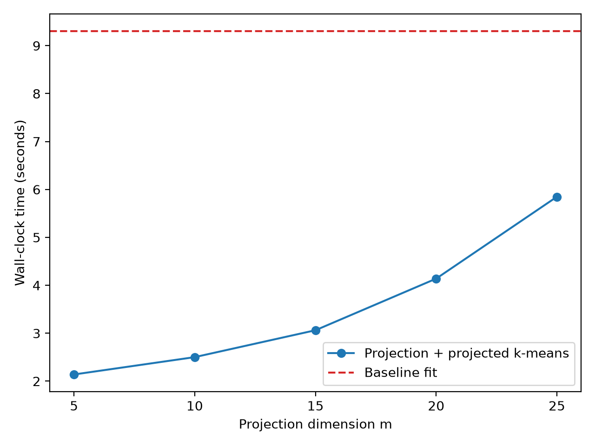

# CSE558 Assignment 1
- Divyanshi - 2023029
- Saksham Arora - 2023466

## Setup 
Create a virtual environment using
`python3 -m venv .venv`. Activate it and then install dependecies using `pip install -r requirements.txt`

## Data preprocessing:
After one-hot encoding `protocol_type`, `service`, and
`flag`, converting numeric features to float32, dropping 2 constant columns,
and min–max scaling each retained column to [0, 1], the resulting matrix
$D \in \mathbb{R}^{n \times d}$ has $n = 494{,}021$ rows and $d = 116$ columns.

# Q1 - JL for K-means Clustering

In the virtual environment run:
```bash
python q1.py
```

```bash
python q1.py --smoke-test
```

Smoke-test files go into `outputs/q1/smoke_test` and are not assignment results.
The real results go into `outputs/q1`. `--output` changes the destination.


## Measured full-data run

The full experiment completed with seed 42 and one thread. Baseline
cost(D, B) was **53,885.758102**, and fit time was **9.303739 seconds**.
The fixed-partition cost, using freshly computed partition means, was
53,882.886212. These denominators serve different definitions in (b) and (e).
Scikit-learn's float32 inertia was 53,858.359375 (about 0.05% lower than the
direct distance calculation); the ratios consistently use the directly
evaluated cost of its returned centers.

| m | Mean averaged cost | Mean ratio | Min ratio | Max ratio | Mean inverse ratio | Mean projection + fit seconds |
| --- | ---: | ---: | ---: | ---: | ---: | ---: |
| 5 | 63074.056491 | 1.170514 | 1.109947 | 1.316101 | 79.676833 | 2.139861 |
| 10 | 56783.036870 | 1.053767 | 1.002171 | 1.117518 | 74.731834 | 2.501841 |
| 15 | 54239.124478 | 1.006558 | 0.994758 | 1.021401 | 73.297373 | 3.062669 |
| 20 | 55072.049297 | 1.022015 | 0.964865 | 1.085662 | 67.198197 | 4.139601 |
| 25 | 53424.278538 | 0.991436 | 0.967193 | 1.020824 | 68.157538 | 5.847443 |

### 1(b): How the averaged-centroid ratio changes with m

As m increases from 5 to 25, the mean ratio cost(D, B-hat)/cost(D, B)
falls overall from 1.1705 to 0.9914. It is not strictly decreasing: the
mean rises from 1.0066 at m=15 to 1.0220 at m=20. The min-to-max range
also narrows overall, from about 0.206 at m=5 to 0.054 at m=25, although
it too is not monotone. This agrees with the JL intuition: larger m
typically preserves the original geometry more accurately. For a fixed
failure probability and set of points, the distortion bound scales as
1/sqrt(m), with an additional logarithmic dependence on the set size.
This does not guarantee monotonic k-means results in five random trials.

Ratios below 1 occur at m=15 (0.9948), m=20 (0.9649), and m=25
(0.9672, 0.9755 and 0.9801). Finding a global k-means optimum is NP-hard;
the baseline KMeans with n_init=5 selects the best of five local runs,
rather than guaranteeing that optimum. Projection changes the geometry
and can guide Lloyd's algorithm to a different partition. Averaging that
partition's original rows can yield centers with a lower original-space
cost than the baseline found. A ratio below 1 therefore does not contradict
the definition of the objective.

### 1(c): Averaged centroids versus pseudo-inverse reconstruction

The mean pseudo-inverse ratios are about 67–80, whereas the averaged-center
mean ratios at m=15, 20 and 25 are 1.0066, 1.0220 and 0.9914. Thus averaging
is within about 2.2% of baseline on average at these dimensions, and is
overwhelmingly better than pseudo-inverse reconstruction in this experiment.

A has shape m by 116. Its pseudo-inverse maps a projected center back into
the row space of A, assigning zero to its components in the (116-m)-dimensional
orthogonal complement. Those original coordinates cannot be recovered from
the projected center alone. In contrast, B-hat averages the actual original
rows in each projected cluster, retaining their full 116-dimensional
coordinates. It also minimizes within-cluster squared error for that fixed
partition. We would use B-hat for this task; the measured nearest-center
costs strongly support that choice.

### 1(d): Runtime comparison

Projection plus projected k-means takes 2.14 seconds at m=5 and 5.85 seconds
at m=25, compared with a 9.30-second baseline fit. This gives speedups of
about 4.35 times and 1.59 times, respectively. Mean projected runtimes
increase with m in this run. At m=15–25, averaged-center mean costs are
within about 2.2% of baseline while taking less time. The projected timings
include forming E and fitting k-means, but exclude drawing A, reconstructing
centers and evaluating their costs. The baseline timing includes fitting
only.



### 1(e): Pairwise distance versus fixed-partition cost distortion

| m | Pairwise ratio sample std | Partition ratio sample std |
| --- | ---: | ---: |
| 5 | 0.475525 | 0.181266 |
| 10 | 0.426469 | 0.108614 |
| 15 | 0.193917 | 0.081924 |
| 20 | 0.257170 | 0.059091 |
| 25 | 0.326859 | 0.056874 |

The partition ratios have smaller spread for every m, and their measured
standard deviations decrease throughout. At m=5, the 10,000 pairwise ratios
range from 0.0269 to 3.7500, while the 20 partition ratios range from 0.6054
to 1.1784. At m=25, the partition ratios range from 0.8978 to 1.0991 around
1. The side-by-side box plots below compare the two distributions.


For any fixed nonzero difference vector, its squared-distance ratio over
independent Gaussian projections follows chi-squared(m)/m, with mean 1,
variance 2/m and standard deviation sqrt(2/m). A partition cost combines
the squared norms of residual vectors across 494,021 points in 15 clusters.
Combining different residual directions reduces fluctuations, explaining
the narrower partition-cost distribution here. However, all rows share A,
so the projection errors are correlated: the reduction is not simply
averaging 494,021 independent errors.

More precisely, let R contain original rows minus their fixed-partition
means, and G = R.T @ R. Then cost_D(C_D) = trace(G), and
cost_E(C_D) = trace(A @ G @ A.T). The latter identity is also used in the
code to avoid repeatedly projecting the full dataset. The partition ratio's
standard deviation over Gaussian draws is
sqrt(2/m) * ||G||_F / trace(G). Its reduction relative to a single pair
depends on the diversity of the residual directions.

Both theoretical standard deviations scale as 1/sqrt(m). The measured
pairwise spreads are less regular: each m uses only one projection shared
by all sampled pairs, so 10,000 pairs do not constitute 10,000 independent
draws of A. In particular, the observed pairwise standard deviation
increases after m=15 despite the decreasing theoretical variance for any
fixed pair over independent projection draws. We therefore report an
overall concentration tendency, not a monotonic decrease in every observed
spread.

## References

* **KDD Cup 1999 Dataset Loader (`fetch_kddcup99`):** https://scikit-learn.org/stable/modules/generated/sklearn.datasets.fetch_kddcup99.html
* **k-Means Clustering (`sklearn.cluster.KMeans`):** https://scikit-learn.org/stable/modules/generated/sklearn.cluster.KMeans.html
* **Pandas One-Hot Encoding (`pandas.get_dummies`):** https://pandas.pydata.org/docs/reference/api/pandas.get_dummies.html
* **NumPy Random Generator (`numpy.random.Generator`):** https://numpy.org/doc/stable/reference/random/generator.html
* **Moore–Penrose Pseudo-Inverse (`numpy.linalg.pinv`):** https://numpy.org/doc/stable/reference/generated/numpy.linalg.pinv.html
* **Ordinary Least Squares (`numpy.linalg.lstsq`):** https://numpy.org/doc/stable/reference/generated/numpy.linalg.lstsq.html
* **Unbuffered In-Place Accumulation (`numpy.add.at`):** https://numpy.org/doc/stable/reference/generated/numpy.add.at.html
* **Woodruff, D. P. (2014).** *Sketching as a Tool for Numerical Linear Algebra.* Foundations and Trends in Theoretical Computer Science, 10(1–2), 1–157. https://www.cs.cmu.edu/~dwoodruf/fnt.pdf
* **CountSketch Data Structure (Overview):** https://en.wikipedia.org/wiki/Count_sketch