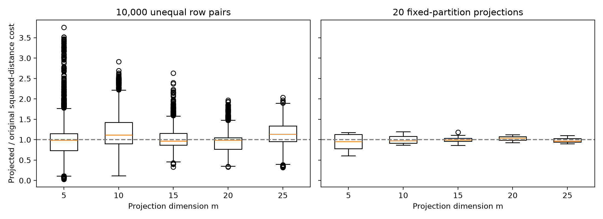
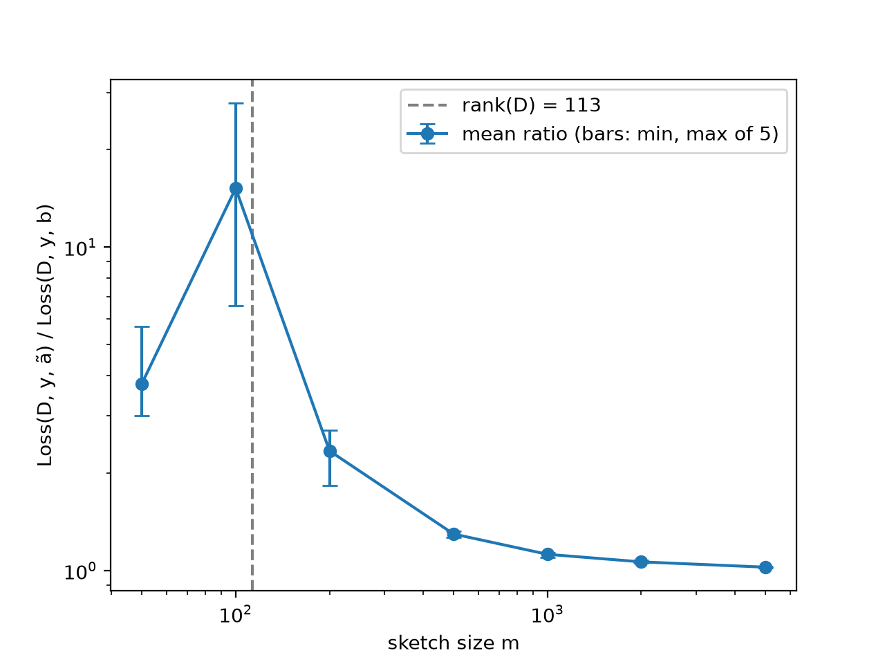
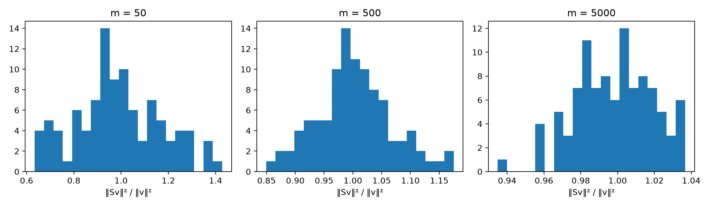

# CSE558 Assignment 1
- Divyanshi - 2023209
- Saksham Arora - 2023466

Code: https://github.com/drdben/2023209-2023466-DSA1

## Setup 
Create a virtual environment using
`python3 -m venv .venv`. Activate it and then install dependecies using `pip install -r requirements.txt`

## Data preprocessing:
After one-hot encoding `protocol_type`, `service`, and
`flag`, converting numeric features to float32, dropping 2 constant columns,
and min–max scaling each retained column to [0, 1], the resulting matrix
$D \in \mathbb{R}^{n \times d}$ has $n = 494{,}021$ rows and $d = 116$ columns.

# Q1 - JL for K-means Clustering

In the virtual environment run:
```bash
python q1.py
```

```bash
python q1.py --smoke-test
```

Smoke-test files go into `outputs/q1/smoke_test` and are not assignment results.
The real results go into `outputs/q1`. `--output` changes the destination.


## Measured full-data run

The full experiment completed with seed 42 and one thread. Baseline
cost(D, B) was **53,885.758102**, and fit time was **3.018532 seconds**.
The fixed-partition cost, using freshly computed partition means, was
53,882.886212. These denominators serve different definitions in (b) and (e).
Scikit-learn's float32 inertia was 53,858.359375 (about 0.05% lower than the
direct distance calculation); the ratios consistently use the directly
evaluated cost of its returned centers.

E is computed in float64. With a float32 E, the same seeds gave different
k-means partitions for 13 of the 25 runs on two machines: tiny rounding
differences in D A^T sent Lloyd's algorithm to different local optima.
Wall-clock times depend on the machine.

| m | Mean cost(D, B-hat) | Mean ratio | Min ratio | Max ratio | Mean B+ ratio | Min B+ ratio | Max B+ ratio | Mean projection + fit seconds |
| --- | ---: | ---: | ---: | ---: | ---: | ---: | ---: | ---: |
| 5 | 67873.09 | 1.2596 | 1.1870 | 1.3169 | 79.68 | 78.89 | 80.36 | 2.238 |
| 10 | 56322.97 | 1.0452 | 0.9971 | 1.1551 | 74.73 | 73.43 | 76.16 | 2.237 |
| 15 | 55690.29 | 1.0335 | 1.0024 | 1.0920 | 73.30 | 71.80 | 76.46 | 2.151 |
| 20 | 56381.47 | 1.0463 | 0.9801 | 1.1134 | 67.20 | 64.29 | 70.36 | 2.359 |
| 25 | 55325.68 | 1.0267 | 1.0037 | 1.0488 | 68.17 | 66.07 | 69.86 | 2.423 |

All 25 runs (ratios are to cost(D, B) = 53,885.758102):

| m | Run | cost(D, B-hat) | cost(D, B-hat)/cost(D, B) | cost(D, B+)/cost(D, B) | Projection + fit seconds |
| --- | ---: | ---: | ---: | ---: | ---: |
| 5 | 1 | 63962.89 | 1.1870 | 79.42 | 2.176 |
| 5 | 2 | 68086.04 | 1.2635 | 80.34 | 2.375 |
| 5 | 3 | 67342.71 | 1.2497 | 79.37 | 2.005 |
| 5 | 4 | 70964.55 | 1.3169 | 78.89 | 2.417 |
| 5 | 5 | 69009.28 | 1.2807 | 80.36 | 2.216 |
| 10 | 1 | 54703.38 | 1.0152 | 76.09 | 2.112 |
| 10 | 2 | 54401.83 | 1.0096 | 76.16 | 2.418 |
| 10 | 3 | 53728.69 | 0.9971 | 73.43 | 2.023 |
| 10 | 4 | 62245.05 | 1.1551 | 73.45 | 2.389 |
| 10 | 5 | 56535.91 | 1.0492 | 74.53 | 2.244 |
| 15 | 1 | 55867.06 | 1.0368 | 71.84 | 2.178 |
| 15 | 2 | 54014.65 | 1.0024 | 72.67 | 2.051 |
| 15 | 3 | 58840.67 | 1.0920 | 76.46 | 2.372 |
| 15 | 4 | 54419.94 | 1.0099 | 73.72 | 2.215 |
| 15 | 5 | 55309.11 | 1.0264 | 71.80 | 1.936 |
| 20 | 1 | 55670.11 | 1.0331 | 64.29 | 1.956 |
| 20 | 2 | 59996.87 | 1.1134 | 66.47 | 2.228 |
| 20 | 3 | 52812.43 | 0.9801 | 70.36 | 2.333 |
| 20 | 4 | 55627.81 | 1.0323 | 64.67 | 2.649 |
| 20 | 5 | 57800.13 | 1.0726 | 70.21 | 2.629 |
| 25 | 1 | 55129.98 | 1.0231 | 69.86 | 2.425 |
| 25 | 2 | 54087.37 | 1.0037 | 66.26 | 2.707 |
| 25 | 3 | 56514.77 | 1.0488 | 66.07 | 2.268 |
| 25 | 4 | 55410.45 | 1.0283 | 69.06 | 2.337 |
| 25 | 5 | 55485.82 | 1.0297 | 69.58 | 2.376 |

### 1(b): How the averaged-centroid ratio changes with m

The mean ratio cost(D, B-hat)/cost(D, B) drops sharply from 1.2596 at
m=5 to 1.0452 at m=10. For m=10–25 it stays between 1.027 and 1.046 and
is not strictly decreasing: it rises from 1.0335 at m=15 to 1.0463 at
m=20. The min-to-max range narrows overall, from 0.130 at m=5 to 0.045
at m=25, although it too is not monotone (0.158 at m=10). This agrees with the JL intuition: larger m
typically preserves the original geometry more accurately. For a fixed
failure probability and set of points, the distortion bound scales as
1/sqrt(m), with an additional logarithmic dependence on the set size.
This does not guarantee monotonic k-means results in five random trials.

Ratios below 1 occur at m=10 (0.9971, run 3) and m=20 (0.9801, run 3).
Finding a global k-means optimum is NP-hard;
the baseline KMeans with n_init=5 selects the best of five local runs,
rather than guaranteeing that optimum. Projection changes the geometry
and can guide Lloyd's algorithm to a different partition. Averaging that
partition's original rows can yield centers with a lower original-space
cost than the baseline found. A ratio below 1 therefore does not contradict
the definition of the objective.

### 1(c): Averaged centroids versus pseudo-inverse reconstruction

The mean pseudo-inverse ratios are about 67–80, whereas the averaged-center
mean ratios at m=15, 20 and 25 are 1.0335, 1.0463 and 1.0267. Thus averaging
is within about 4.6% of baseline on average at these dimensions, and is
overwhelmingly better than pseudo-inverse reconstruction in this experiment.

A has shape m by 116. Its pseudo-inverse maps a projected center back into
the row space of A, assigning zero to its components in the (116-m)-dimensional
orthogonal complement. Those original coordinates cannot be recovered from
the projected center alone. In contrast, B-hat averages the actual original
rows in each projected cluster, retaining their full 116-dimensional
coordinates. It also minimizes within-cluster squared error for that fixed
partition. We would use B-hat for this task; the measured nearest-center
costs strongly support that choice.

### 1(d): Runtime comparison

Projection plus projected k-means takes 2.15–2.42 seconds on average for
every m, compared with a 3.02-second baseline fit. This gives speedups
between 1.25 times (m=25) and 1.40 times (m=15). The mean projected time
barely changes with m and is not monotone: at m ≤ 25 each Lloyd iteration
on E is cheap, so run-to-run variation (single runs at m=15–20 take 1.94–2.65 seconds)
is as large as the effect of m. At m=10–25, averaged-center mean costs are
within about 4.6% of baseline while taking less time. The projected timings
include forming E and fitting k-means, but exclude drawing A, reconstructing
centers and evaluating their costs. The baseline timing includes fitting
only.


### 1(e): Pairwise distance versus fixed-partition cost distortion

| m | Pairwise ratio sample std | Partition ratio sample std |
| --- | ---: | ---: |
| 5 | 0.475525 | 0.181266 |
| 10 | 0.426469 | 0.108614 |
| 15 | 0.193917 | 0.081924 |
| 20 | 0.257170 | 0.059091 |
| 25 | 0.326859 | 0.056874 |

The partition ratios have smaller spread for every m, and their measured
standard deviations decrease throughout. At m=5, the 10,000 pairwise ratios
range from 0.0269 to 3.7500, while the 20 partition ratios range from 0.6054
to 1.1784. At m=25, the partition ratios range from 0.8978 to 1.0991 around
1. The side-by-side box plots below compare the two distributions.



For any fixed nonzero difference vector, its squared-distance ratio over
independent Gaussian projections follows chi-squared(m)/m, with mean 1,
variance 2/m and standard deviation sqrt(2/m). A partition cost combines
the squared norms of residual vectors across 494,021 points in 15 clusters.
Combining different residual directions reduces fluctuations, explaining
the narrower partition-cost distribution here. However, all rows share A,
so the projection errors are correlated: the reduction is not simply
averaging 494,021 independent errors.

More precisely, let R contain original rows minus their fixed-partition
means, and G = R.T @ R. Then cost_D(C_D) = trace(G), and
cost_E(C_D) = trace(A @ G @ A.T). The latter identity is also used in the
code to avoid repeatedly projecting the full dataset. The partition ratio's
standard deviation over Gaussian draws is
sqrt(2/m) * ||G||_F / trace(G). Its reduction relative to a single pair
depends on the diversity of the residual directions.

Both theoretical standard deviations scale as 1/sqrt(m). The measured
pairwise spreads are less regular: each m uses only one projection shared
by all sampled pairs, so 10,000 pairs do not constitute 10,000 independent
draws of A. In particular, the observed pairwise standard deviation
increases after m=15 despite the decreasing theoretical variance for any
fixed pair over independent projection draws. We therefore report an
overall concentration tendency, not a monotonic decrease in every observed
spread.

# Q2 - JL for Linear Regression

In the virtual environment run:
```bash
python q2.py
```

It prints every number below (saved in `outputs/q2/results.txt`) and writes
the plots `outputs/q2/ratio.png` and `outputs/q2/residual_hist.png`. Sketches
use seed 42; the 50,000-row subset in (e) uses its own seed 0. D is cast to
float64. A CountSketch is never stored: `np.add.at` adds row i, times
σ(i), to row h(i). D and y are sketched together as the matrix [D | y], so
the same S is applied to both. Least-squares solves use NumPy's default
thread count.

rank(D) = **113**, three less than d = 116. Two of the dependencies come
from the one-hot columns: within each of protocol_type, service and flag
the columns sum to 1 on every row.

### 2(a): Full least squares

Loss(D, y, b) = **2949.7888**, and computing b with `numpy.linalg.lstsq`
took **0.971 seconds**.

### 2(b): Sketched least squares

| m | Run | Loss(D, y, ã) | Ratio to Loss(D, y, b) | Sketched loss | Seconds |
| --- | ---: | ---: | ---: | ---: | ---: |
| 50 | 1 | 10002.2960 | 3.3909 | 1.2664e-23 | 0.329 |
| 50 | 2 | 10223.1174 | 3.4657 | 9.7473e-24 | 0.291 |
| 50 | 3 | 9796.7316 | 3.3212 | 4.8983e-24 | 0.291 |
| 50 | 4 | 8890.5910 | 3.0140 | 1.7962e-24 | 0.295 |
| 50 | 5 | 16756.0259 | 5.6804 | 3.4289e-23 | 0.291 |
| 100 | 1 | 30557.8704 | 10.3593 | 2.1385e-23 | 0.297 |
| 100 | 2 | 57980.6209 | 19.6559 | 9.7183e-24 | 0.293 |
| 100 | 3 | 82239.5306 | 27.8798 | 1.2763e-24 | 0.300 |
| 100 | 4 | 33775.8200 | 11.4503 | 1.9048e-23 | 0.322 |
| 100 | 5 | 19417.9123 | 6.5828 | 8.3938e-24 | 0.302 |
| 200 | 1 | 7993.9860 | 2.7100 | 1.4489e+03 | 0.294 |
| 200 | 2 | 7108.0646 | 2.4097 | 1.2318e+03 | 0.293 |
| 200 | 3 | 6754.3218 | 2.2898 | 1.2467e+03 | 0.293 |
| 200 | 4 | 7284.1061 | 2.4694 | 1.0342e+03 | 0.294 |
| 200 | 5 | 5391.4550 | 1.8277 | 1.4122e+03 | 0.295 |
| 500 | 1 | 3827.0745 | 1.2974 | 2.6330e+03 | 0.304 |
| 500 | 2 | 3731.0334 | 1.2648 | 1.9844e+03 | 0.301 |
| 500 | 3 | 3852.9094 | 1.3062 | 2.1325e+03 | 0.295 |
| 500 | 4 | 3900.3391 | 1.3222 | 2.3465e+03 | 0.296 |
| 500 | 5 | 3794.0233 | 1.2862 | 2.3487e+03 | 0.320 |
| 1000 | 1 | 3293.1515 | 1.1164 | 2.4379e+03 | 0.296 |
| 1000 | 2 | 3338.9883 | 1.1319 | 2.5897e+03 | 0.295 |
| 1000 | 3 | 3338.9967 | 1.1319 | 2.6945e+03 | 0.296 |
| 1000 | 4 | 3229.5656 | 1.0948 | 2.6772e+03 | 0.311 |
| 1000 | 5 | 3331.9153 | 1.1295 | 2.7248e+03 | 0.296 |
| 2000 | 1 | 3150.6602 | 1.0681 | 2.8213e+03 | 0.298 |
| 2000 | 2 | 3175.2059 | 1.0764 | 2.7324e+03 | 0.299 |
| 2000 | 3 | 3108.7078 | 1.0539 | 2.8498e+03 | 0.299 |
| 2000 | 4 | 3104.7662 | 1.0525 | 2.8414e+03 | 0.299 |
| 2000 | 5 | 3126.6580 | 1.0600 | 2.8945e+03 | 0.299 |
| 5000 | 1 | 3005.3858 | 1.0188 | 2.8446e+03 | 0.306 |
| 5000 | 2 | 3018.9537 | 1.0234 | 2.8990e+03 | 0.309 |
| 5000 | 3 | 3017.5306 | 1.0230 | 2.9643e+03 | 0.313 |
| 5000 | 4 | 3016.7560 | 1.0227 | 2.8960e+03 | 0.306 |
| 5000 | 5 | 3027.7347 | 1.0264 | 2.8323e+03 | 0.308 |

| m | Mean ratio | Min ratio | Max ratio | Mean sketched loss | Mean seconds |
| --- | ---: | ---: | ---: | ---: | ---: |
| 50 | 3.7744 | 3.0140 | 5.6804 | ≈ 0 | 0.299 |
| 100 | 15.1856 | 6.5828 | 27.8798 | ≈ 0 | 0.303 |
| 200 | 2.3413 | 1.8277 | 2.7100 | 1274.8 | 0.294 |
| 500 | 1.2954 | 1.2648 | 1.3222 | 2289.0 | 0.303 |
| 1000 | 1.1209 | 1.0948 | 1.1319 | 2624.8 | 0.299 |
| 2000 | 1.0622 | 1.0525 | 1.0764 | 2827.9 | 0.299 |
| 5000 | 1.0229 | 1.0188 | 1.0264 | 2887.2 | 0.308 |



**Below rank(D) (m = 50, 100).** SD has only m < 113 rows, so SD a = Sy has
infinitely many exact solutions and `lstsq` returns the minimum-norm one.
The sketched loss is 0 up to rounding (about 1e-23) for every run, so it
says nothing about the true loss. The true loss is 3–28 times the optimum,
and the runs vary widely. The ratio is worse at m=100 (mean 15.2) than at
m=50 (mean 3.8). As m nears the rank, SD approaches a square, poorly
conditioned system on its row space, and the exact fit to the sketched
data amplifies the sketch noise. Among the tested m, the ratio is largest
at m=100, the closest to rank(D).

**Above rank(D) (m ≥ 200).** SD has full column rank 113, the solution is
unique, and the ratio falls steadily towards 1: 2.34, 1.30, 1.12, 1.06 and
1.023, with a narrower spread as m grows. The sketched loss is now
positive but below Loss(D, y, b), and rises towards 2949.79 as m grows. It
underestimates because ã is fitted to the sketched data. For a Gaussian S
one can show E[ratio] = 1 + r/(m − r − 1) and E[sketched loss] =
Loss(D, y, b)(m − r)/m with r = rank(D). These predict ratios 2.31, 1.29,
1.13, 1.06 and 1.023 and sketched losses 1283, 2283, 2616, 2783 and 2883
for m = 200, …, 5000. The CountSketch results are close to both.

### 2(c): Time

Drawing S, forming SD and Sy, and computing ã takes 0.294–0.308 seconds
on average for every m, against 0.971 seconds for the full solve: about
3.2 times faster. The time hardly depends on m. Forming SD is one pass
over the n × d matrix, O(nd), whatever m is. The sketched solve costs
O(m d²), which is small next to that even at m = 5000. The full solve
costs O(n d²). It is still under a second here because d = 116 is small.

### 2(d): Norm of the sketched residual

v = Db − y, with ‖v‖² = Loss(D, y, b) = 2949.79. Over 100 CountSketches
for each m:

| m | Mean of ‖Sv‖²/‖v‖² | Std (100 sketches) |
| --- | ---: | ---: |
| 50 | 0.9879 | 0.1826 |
| 500 | 1.0024 | 0.0650 |
| 5000 | 0.9982 | 0.0207 |



The mean is about 1 for every m, because E‖Sv‖² = ‖v‖² for a CountSketch.
The spread shrinks with m: the histograms span roughly 0.63–1.43 at m=50,
0.85–1.18 at m=500 and 0.93–1.04 at m=5000. For a CountSketch,
Var(‖Sv‖²/‖v‖²) = (2/m)(1 − Σ v_i⁴/‖v‖⁴) ≤ 2/m. With no entry of v
dominating, the standard deviation is close to sqrt(2/m) = 0.200, 0.063,
0.020, which matches the table. A 10 times larger m gives about a
sqrt(10) ≈ 3.2 times smaller spread.

### 2(e): CountSketch versus dense Gaussian sketch (n' = 50,000, m = 500)

| Sketch | Mean seconds to draw S and form SD', Sy' | Mean Loss(D', y', ã)/Loss(D', y', b') |
| --- | ---: | ---: |
| CountSketch | 0.030 | 1.3064 |
| Dense Gaussian N(0, 1/m) | 0.102 | 1.2563 |

The dense Gaussian sketch gives a slightly better ratio (1.26 against
1.31), but costs 3.4 times as long, even on 50,000 rows. On the full D we
would use the CountSketch. A dense S would be 500 × 494,021, about 247
million entries (2 GB in float64), and forming SD would cost O(m n d)
operations. The CountSketch never stores S and forms SD in one O(nd) pass,
whatever m is. Its small accuracy gap can be closed more cheaply by
raising m: in (b), m = 1000 already gives a mean ratio of 1.12.

## References

* **KDD Cup 1999 Dataset Loader (`fetch_kddcup99`):** https://scikit-learn.org/stable/modules/generated/sklearn.datasets.fetch_kddcup99.html
* **k-Means Clustering (`sklearn.cluster.KMeans`):** https://scikit-learn.org/stable/modules/generated/sklearn.cluster.KMeans.html
* **Pandas One-Hot Encoding (`pandas.get_dummies`):** https://pandas.pydata.org/docs/reference/api/pandas.get_dummies.html
* **NumPy Random Generator (`numpy.random.Generator`):** https://numpy.org/doc/stable/reference/random/generator.html
* **Moore–Penrose Pseudo-Inverse (`numpy.linalg.pinv`):** https://numpy.org/doc/stable/reference/generated/numpy.linalg.pinv.html
* **Ordinary Least Squares (`numpy.linalg.lstsq`):** https://numpy.org/doc/stable/reference/generated/numpy.linalg.lstsq.html
* **Unbuffered In-Place Accumulation (`numpy.add.at`):** https://numpy.org/doc/stable/reference/generated/numpy.add.at.html
* **Woodruff, D. P. (2014).** *Sketching as a Tool for Numerical Linear Algebra.* Foundations and Trends in Theoretical Computer Science, 10(1–2), 1–157. https://www.cs.cmu.edu/~dwoodruf/fnt.pdf
* **CountSketch Data Structure (Overview):** https://en.wikipedia.org/wiki/Count_sketch